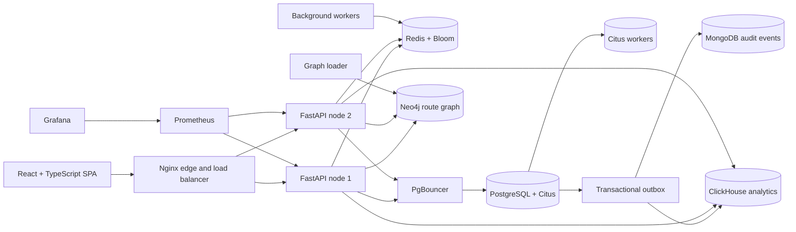

# Airline Reservation System: Distributed Fault-Tolerant Booking Platform

[](#academic-alignment)
[](#technology-stack)
[](http://localhost:8080/docs)

Airline Reservation System (ARS) is a distributed flight search and booking platform developed for **BSCS-606: Distributed Database Systems**. It demonstrates horizontal sharding, colocated transactions, polyglot persistence, asynchronous event processing, observability, load testing, and scripted failover.

The system treats PostgreSQL with Citus as the source of truth for inventory and bookings. Redis, MongoDB, Neo4j, ClickHouse, and pgvector each handle workloads suited to their data model, while the API remains usable when non-critical stores are unavailable.

## Academic Alignment

This project applies the main distributed-database concepts covered by the course:

* **Horizontal sharding:** Citus distributes users, flights, inventory, bookings, tickets, and outbox records across worker nodes.
* **Colocation:** Flight-keyed tables share a distribution key so a booking and its inventory update can be committed on one shard without a distributed transaction.
* **Polyglot persistence:** Redis, MongoDB, Neo4j, ClickHouse, and pgvector are used for cache and holds, audit events, graph traversal, analytics, and similarity search.
* **Consistency design:** Seat sales, inventory, idempotency, and uniqueness are strongly consistent; caches, analytics, graphs, and logs are intentionally eventual.
* **Resilience engineering:** The repository includes health reporting, load shedding, chaos scripts, replicas, and demonstrable coordinator and worker failover.

## Key Features

* Flight search by origin, destination, date, and filters.
* Seat availability, aircraft seat maps, temporary Redis-backed holds, and booking confirmation.
* Database guards that prevent overselling even when Redis is unavailable.
* Idempotent booking creation and unique PNR, seat, username, and email constraints.
* Connecting-flight paths through Neo4j with a PostgreSQL fallback.
* Similar-flight search using pgvector and route-restricted ranking.
* MongoDB audit/search events and ClickHouse booking analytics through a transactional outbox.
* JWT authentication, bcrypt password hashing, rate limiting, and admin-only simulation controls.
* Prometheus metrics, Grafana dashboards, k6 load profiles, and failure-injection scripts.

## System Architecture



The full architecture report, consistency model, sharding strategy, and failure behaviour are documented in [`docs/ARCHITECTURE_REPORT.md`](docs/ARCHITECTURE_REPORT.md).

## Technology Stack

### Frontend

* React 18 with TypeScript and Vite
* React Router for application navigation
* Zustand for client state
* Tailwind CSS for styling
* Recharts and react-force-graph for analytics and route visualisation

### Backend

* Python 3 with FastAPI and Uvicorn
* Pydantic settings and schemas
* asyncpg for PostgreSQL, redis-py for Redis, Motor for MongoDB
* Neo4j Python driver and ClickHouse HTTP integration
* PyJWT and bcrypt for authentication and password security
* Prometheus client instrumentation

### Infrastructure and Testing

* PostgreSQL 16 with Citus and pgvector
* PgBouncer transaction pooling
* Docker Compose for lite and high-availability topologies
* Nginx, Prometheus, and Grafana
* pytest, async API/race tests, k6 load tests, and chaos scripts

## Data Design

PostgreSQL is the authoritative store. The primary flight-keyed tables are colocated on `flight_id`:

```text
airports, airlines, aircraft_types, routes  -> replicated reference tables
users                                        -> distributed by user_id
username_registry, email_registry            -> distributed by registry key
flights, seat_inventory, seats               -> distributed by flight_id
bookings, tickets, outbox                    -> colocated with flights by flight_id
```

Only sold seats are persisted. Free seats are derived from the aircraft layout, sold-seat rows, and active holds. A booking transaction uses uniqueness constraints and guarded inventory updates so concurrent buyers cannot sell the same seat or drive availability below zero.

## REST API

The interactive OpenAPI specification is available at `/docs` when the API is running.

| Method | Endpoint | Description | Auth |
| --- | --- | --- | --- |
| `POST` | `/v1/auth/register` | Register a user | No |
| `POST` | `/v1/auth/login` | Issue a JWT | No |
| `GET` | `/v1/auth/me` | Read the current user | Bearer |
| `GET` | `/v1/flights/search` | Search flights | No |
| `GET` | `/v1/flights/{flight_id}/availability` | Read class availability | No |
| `GET` | `/v1/flights/{flight_id}/seatmap` | Read the seat map | No |
| `POST` | `/v1/holds` | Place a temporary seat hold | Bearer |
| `POST` | `/v1/bookings` | Confirm a booking | Bearer |
| `GET` | `/v1/bookings` | List the current user's bookings | Bearer |
| `DELETE` | `/v1/bookings/{flight_id}/{pnr}` | Cancel a booking | Bearer |
| `GET` | `/v1/routes/path` | Find a connecting route | No |
| `GET` | `/health` | Report dependency health | No |

## Installation and Local Development

### Prerequisites

* Docker Desktop with at least 12 GB allocated memory for the lite stack
* GNU Make and Python 3 for helper commands
* Node.js and npm for frontend-only development

### 1. Configure the environment

Copy the example environment file. Do not commit `.env` or use its development credentials in a public deployment.

```bash
cp .env.example .env
```

On Windows PowerShell:

```powershell
Copy-Item .env.example .env
```

### 2. Start the lite stack

```bash
make up
make init-db
make seed
```

The default seed uses `SCALE=0.01` and is intended for local demonstrations. The complete scale is substantially larger and requires significant CPU, memory, and disk capacity.

Open these services after startup:

* Application: <http://localhost:8080>
* API documentation: <http://localhost:8080/docs>
* Grafana: <http://localhost:3000>
* Prometheus: <http://localhost:9090>

### 3. Start the full high-availability topology

```bash
make up-full
make init-db-ha
make seed
```

The full topology adds API and Nginx nodes, streaming replicas, and a three-member MongoDB replica set. Failover is scripted rather than automatic; see the chaos scripts and architecture report.

## Useful Commands

| Command | Purpose |
| --- | --- |
| `make test` | Run unit and race/API tests |
| `make test-summary` | Run the project verification summary |
| `make health` | Print the dependency health report |
| `make load` | Run the baseline k6 profile |
| `make load-heavy` / `make spike` / `make soak` / `make storm` | Run additional load profiles |
| `make chaos` | Run supported failure scenarios |
| `make verify-distribution` | Verify Citus distribution and colocation |
| `make verify-inventory` | Check inventory and booking invariants |
| `make frontend-dev` | Run the Vite frontend on port 5173 |
| `make logs` | Follow Docker Compose logs |
| `make clean` | Stop the stack and remove local volumes |

## Documentation

* [`docs/ARCHITECTURE_REPORT.md`](docs/ARCHITECTURE_REPORT.md) - architecture, sharding, consistency, and failure behaviour
* [`docs/TRACEABILITY.md`](docs/TRACEABILITY.md) - requirements mapped to implementation and verification commands
* [`docs/TEST_EVIDENCE.md`](docs/TEST_EVIDENCE.md) - executed tests and evidence
* [`docs/DEMO_AND_VIVA.md`](docs/DEMO_AND_VIVA.md) - demonstration flow and viva questions
* [`MEMORY.md`](MEMORY.md) - design decisions, progress, and known deviations

## Troubleshooting

* If `make up` times out, run `make logs` and check that Docker has enough memory.
* If database initialization reports unavailable workers, wait for the worker health checks and rerun `make init-db`.
* If search is empty, run both `make init-db` and `make seed`.
* If ports are busy, change the relevant values in `.env`.
* HTTP 429 responses during load tests indicate expected load shedding; investigate 5xx responses and timeouts instead.


## Author

**Muhammad Hamza Zeeshan**  
BSCS – University of Karachi  
hamzazeeshan675@gmail.com

---

⭐ *Star this repo if you found it helpful or want to contribute!*
