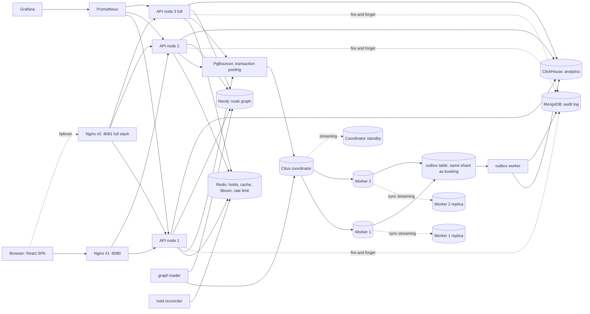

# Architecture report

## Diagram

## Sharding (Citus)
| Table | Kind | Distribution key | Why |
|---|---|---|---|
| airports, airlines, aircraft_types, routes | reference | (replicated to every node) | tiny, joined by everything; joins never cross the network |
| users | distributed | user_id | even spread |
| username_registry | distributed | **username** | the registry PRIMARY KEY lives on the shard that owns the name: check and claim touch exactly one shard |
| email_registry | distributed | **email** | same reasoning |
| flights, seat_inventory, seats, bookings, tickets, outbox | distributed, **co-located** | **flight_id** | everything one booking touches is on ONE shard, so confirm is a single-node ACID transaction, no 2PC |

32 shards over the workers: adding a worker and running `citus_rebalance_start()` moves shards without re-keying anything.
Search is a fan-out over all shards (each returns its top-N from the `(origin, dest, departure_ts)` index; the coordinator merges), joined to reference tables locally.

## Consistency model
- **Strong**: seat sale, inventory, booking, idempotency, username/email/PNR uniqueness (PostgreSQL primary keys and guarded updates on the owning shard).
- **Eventual (by design)**: Redis availability counters (repaired by the reconciler), ClickHouse dashboards, Neo4j graph (hourly), search cache (30 s), MongoDB logs.

## Why the booking cannot oversell (requirement C-11 / N-7)
Inside one transaction on one shard (`app/services/booking_service.py`):
1. `INSERT booking ON CONFLICT DO NOTHING` on `UNIQUE(flight_id, idempotency_key)` makes retries return the first answer.
2. `INSERT seat ON CONFLICT DO NOTHING` on `PRIMARY KEY(flight_id, seat_no)`: the row count must be 1, otherwise rollback and 409. Two buyers can never both insert one seat.
3. `UPDATE seat_inventory SET available = available - n WHERE available >= n` must touch 1 row, plus `CHECK (available >= 0)`.
4. tickets and the outbox event are written in the same transaction (the event exists if and only if the booking exists).

Redis holds are advisory (nicer errors, 10 minute reservation). If Redis is lost the DB guards above still prevent every double sale.
Only SOLD seats are stored (7.5 billion seat rows would be absurd); the seat map is the aircraft layout minus sold rows minus live holds.

## O(1) username check with many coordinators (C-13 / F-2)
`username_registry` is hash-distributed by username. Whichever coordinator or API node answers, the lookup is a primary-key probe on one shard: cost does not grow with users, nodes or coordinators.
A Redis Bloom filter answers "definitely free" without touching Postgres. It can only be wrong in the safe direction (false "maybe taken"), and is trusted only when `bloom:ready` is set.
Registration claims the name by inserting into the registry first; the PRIMARY KEY lets exactly one concurrent registration win. Failed registrations are compensated (rows deleted).

## Availability and failure behaviour
| Failure | Effect |
|---|---|
| API node dies | Nginx passive health check + retry on another node; no user-visible error |
| Nginx #1 dies (full) | Nginx #2 on :8081 |
| Redis dies | search works (uncached), bookings use DB guards only, `/health` = degraded, rate limit fails open |
| MongoDB / Neo4j / ClickHouse die | search + booking unaffected; route graph falls back to PostgreSQL; outbox buffers events and drains on recovery |
| Citus worker primary dies (full) | replica promoted by `chaos/failover_worker.sh`; synchronous replication means no committed booking is lost; target < 30 s |
| Coordinator dies (full) | standby promoted by `chaos/failover_coordinator.sh`; PgBouncer reconnects by DNS name |
| Lite stack: a worker dies | data on its shards is unavailable (no replica); the API stays up and answers 503 DEGRADED only for affected requests |
| Overload | Nginx per-IP limit and the Redis token bucket shed excess with HTTP 429; bounded DB pool and backlog |

Automatic failover (Patroni/repmgr) is out of scope; promotion is scripted and demonstrable. Synchronous replication trades write availability for durability: if the replica is down, writes to that shard wait.

## Polyglot persistence
| Store | Workload | Why this store |
|---|---|---|
| PostgreSQL + Citus | transactions, search | ACID, constraints, sharding |
| Redis (+Bloom) | holds, counters, cache, rate limit, existence pre-check | sub-millisecond, TTL, atomic Lua |
| MongoDB | search events, view counters, audit log | schemaless, write-heavy, loss tolerant |
| Neo4j | route network, connecting paths | variable-length path traversal |
| ClickHouse | bookings/day, revenue, top routes, peak hours | columnar aggregation over millions of events |
| pgvector | similar flights | embeddings next to the data, route-restricted exact search |

## Deviations from the spec (all deliberate, also in MEMORY.md)
1. Outbox drain uses plain polling with idempotent sinks instead of `SELECT .. FOR UPDATE SKIP LOCKED`, because Citus cannot lock rows across shards in one query.
2. The HNSW index exists, but similar-flight queries filter by route and a +-3 day window first and rank exactly, because filtered ANN queries are unreliable.
3. `seats` stores sold seats only.
4. The idempotency key and PNR are unique per flight (the owning shard); `GET/DELETE` booking endpoints therefore include `flight_id`.
